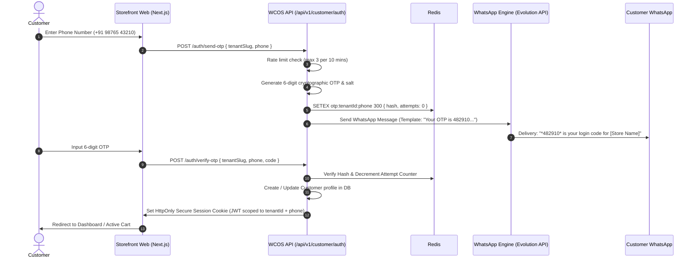
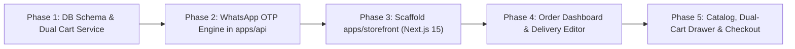

# The Omnichannel Luxury Storefront & Customer Dashboard
### Architectural Specification & Haute-Design System for WhatsApp Commerce OS (WCOS)

---

## 1. Executive Design Philosophy: The "Anti-AI" Standard

Most AI-generated and contemporary "vibe-coded" SaaS interfaces suffer from predictable clichés: oversaturated gradients, generic purple/indigo accent colors, over-rounded bubbles (`rounded-3xl` everywhere), cramped card grids, and visual noise.

This product is engineered to reflect the **haute-horlogerie and luxury fashion e-commerce standard**—drawing direct inspiration from platforms like **SSENSE, Bottega Veneta, Aesop, Rimowa, Apple, and Linear**, infused with interaction paradigms curated by **Codrops** and award-winning international digital agencies (Studio Freight, Locomotive, Basic/Dept).

### Core Pillars of the Aesthetic
1. **Quiet Luxury & Restraint**: Generous whitespace is treated as the primary luxury signifier. If a discount store crams 20 items above the fold, a luxury house gives an item breathing room to command respect.
2. **Tactile Materiality & Hairline Precision**: Eliminating harsh drop shadows in favor of razor-sharp hairline borders (`0.5px` border tokens), subtle backdrop blurs (`backdrop-blur-md`), and matte ceramic/stone surface tones.
3. **Editorial Typography**: Pairing an authentic, high-contrast serif (for headlines, emotional moments, and product titles) with a precise, ultra-legible neutral grotesque sans-serif (for functional UI, tables, and micro-labels), accented by a refined monospace font for numbers, prices, and tracking IDs.
4. **Fluid Kinetic Micro-Interactions**: Physics-governed easing curves (`cubic-bezier(0.16, 1, 0.3, 1)`), staggered content reveals, frictionless magnetic drawers, and discreet haptic confirmations.
5. **Whisper-Quiet Omnichannel Presence**: WhatsApp synchronization is not shouted with obnoxious neon banners; it is indicated with quiet typographic status chips, precise timestamps, and ambient sync pulses.

---

## 2. Color Science & Material System

The palette avoids sterile pure grays and artificial neons. It is rooted in architectural minerals: Obsidian, Warm Alabaster, Chalk, Aged Brass, and subtle Forest Sage.

```
┌────────────────────────────────────────────────────────────────────────┐
│                        ARCHITECTURAL PALETTE                           │
├─────────────┬─────────────┬─────────────┬─────────────┬────────────────┤
│  OBSIDIAN   │  ALABASTER  │   CALICO    │ AGED BRASS  │ EMERALD WHISPER│
│   #0C0C0C   │   #F9F8F6   │   #E8E6E1   │   #C5A880   │    #10B981     │
│ Main Text   │ Background  │ Hairlines   │ Accent/Gold │ Sync Active    │
└─────────────┴─────────────┴─────────────┴─────────────┴────────────────┘
```

### 2.1 Design Tokens (Tailwind & CSS Variables)

```css
:root {
  /* Surfaces */
  --bg-primary: #FDFCF9;          /* Warm alabaster paper */
  --bg-secondary: #F4F2EB;        /* Subtle stone container */
  --bg-tertiary: #EBE8DE;         /* Elevated card surface */
  --bg-elevated: #FFFFFF;         /* Crisp modal / floating surface */
  --bg-inverse: #0C0C0C;          /* Deep obsidian */

  /* Text & Glyphs */
  --text-primary: #0C0C0C;        /* Deep obsidian black */
  --text-secondary: #5C5B57;      /* Warm architectural charcoal */
  --text-muted: #8F8E8A;          /* Quiet label stone */
  --text-inverse: #FDFCF9;        /* Alabaster on dark */

  /* Hairlines & Dividers (0.5px to 1px) */
  --border-subtle: rgba(12, 12, 12, 0.06);
  --border-medium: rgba(12, 12, 12, 0.12);
  --border-focused: #0C0C0C;

  /* Accents & States */
  --accent-gold: #C5A880;         /* Muted Champagne / Brushed Brass */
  --accent-gold-hover: #B2956D;
  --status-live: #059669;         /* Subdued luxury emerald for WA sync */
  --status-pending: #D97706;      /* Muted amber */
  --status-danger: #991B1B;       /* Deep carmine for cancellations */

  /* Radii (Architectural, intentional) */
  --radius-xs: 2px;
  --radius-sm: 4px;
  --radius-md: 6px;
  --radius-lg: 10px;              /* Maximum corner roundness; no bulbous pills */

  /* Shadows (Replaced by hairline borders and ambient contact shadows) */
  --shadow-float: 0 20px 40px -15px rgba(12, 12, 12, 0.05);
  --shadow-drawer: -15px 0 50px -10px rgba(12, 12, 12, 0.08);
}

.dark {
  --bg-primary: #0A0A0A;          /* Infinite dark slate */
  --bg-secondary: #121212;        /* Card surface */
  --bg-tertiary: #1A1A1A;
  --bg-elevated: #161616;
  --bg-inverse: #F9F8F6;

  --text-primary: #F4F2EB;
  --text-secondary: #9E9D98;
  --text-muted: #5C5B57;
  --text-inverse: #0C0C0C;

  --border-subtle: rgba(255, 255, 255, 0.07);
  --border-medium: rgba(255, 255, 255, 0.14);
  --border-focused: #F4F2EB;

  --accent-gold: #D6BD9B;
  --status-live: #10B981;
}
```

---

## 3. Typographic Science & Grid System

```
Typographic Trio:
1. Editorial Serif  : Newsreader / Cormorant Garamond (Titles, Brand, Emotions)
2. Grotesque Sans   : Geist Sans / Satoshi / Inter (Functional UI, Controls)
3. Precision Mono   : Geist Mono / Commit Mono (Dates, Prices, Order Numbers, OTP)
```

### 3.1 Typographic Hierarchy
| Hierarchy Level | Font Family | Size | Leading | Tracking | Case / Weight | Purpose |
| :--- | :--- | :--- | :--- | :--- | :--- | :--- |
| **Display 01** | Editorial Serif | 3.5rem (56px) | 1.05 | -0.03em | Light (300) | Storefront Hero & Brand Title |
| **Headline 02**| Editorial Serif | 2.25rem (36px) | 1.15 | -0.02em | Regular (400) | Section Titles, Order Success |
| **Subhead 01**  | Grotesque Sans  | 1.125rem (18px)| 1.4  | -0.01em | Medium (500) | Product Titles, Order Numbers |
| **Body Regular**| Grotesque Sans  | 0.9375rem (15px)| 1.6  | 0        | Regular (400) | Descriptions, Customer Messages |
| **Micro Monospace**| Precision Mono| 0.75rem (12px) | 1.2  | +0.06em | Medium (500) / ALL CAPS | Prices, SKUs, AWB, Timestamps |
| **Overline Chip**| Grotesque Sans  | 0.6875rem (11px)| 1.0  | +0.12em | Bold (700) / ALL CAPS | Status badges, "SYNCED WITH WA" |

---

## 4. The Dual-Cart Architectural Model

To honor the natural distinction between conversational sales and visual web browsing, the platform implements a **Dual-Cart Architecture** with strict channel scoping:

```
┌────────────────────────────────────────────────────────────────────────┐
│                        DUAL-CART ARCHITECTURE                          │
├───────────────────────────────────┬────────────────────────────────────┤
│ 1. WhatsApp Cart (Concierge Cart) │ 2. Web Cart (Boutique Cart)        │
│ Redis: `cart:wa:{tenantId}:{phone}`│ Redis: `cart:web:{tenantId}:{phone}`│
├───────────────────────────────────┼────────────────────────────────────┤
│ • Populated via WhatsApp AI chat  │ • Populated via Web storefront UI  │
│ • Accessible in WhatsApp Chat: YES│ • Accessible in WhatsApp Chat: NO  │
│ • Accessible on Website: YES      │ • Accessible on Website: YES       │
└───────────────────────────────────┴────────────────────────────────────┘
```

```mermaid
flowchart TD
    subgraph Channels["Interaction Channels"]
        WA["WhatsApp Client<br/>(Conversational Bot)"]
        WEB["Customer Web Storefront<br/>(Next.js 15 App)"]
    end

    subgraph Carts["Isolated Redis Cart State"]
        WACart[("WhatsApp Concierge Cart<br/>cart:wa:tenantId:phone")]
        WebCart[("Web Boutique Cart<br/>cart:web:tenantId:phone")]
    end

    subgraph Actions["Web Dual-Cart Capabilities"]
        ViewBoth["View Both Carts via Segmented Tabs"]
        MergeOption["Option: Merge Carts Into Single Checkout"]
        IndieOption["Option: Checkout Independently"]
    end

    %% Channel to Cart Access
    WA <-->|Read / Write (Exclusive)| WACart
    WA -.->|Blocked / Isolated| WebCart

    WEB <-->|Read / Write| WebCart
    WEB <-->|Read / Write| WACart

    WEB --> ViewBoth
    ViewBoth --> MergeOption
    ViewBoth --> IndieOption
```

### 4.1 Channel Access Rules & Justification

1. **WhatsApp Isolation**:
   - The AI sales assistant in WhatsApp only sees and manipulates the **WhatsApp Concierge Cart** (`cart:wa:{tenantId}:{customerPhone}`).
   - *Why?* A customer casually browsing 10 products on a website should not clutter or confuse the ongoing conversational AI dialogue on WhatsApp. If the customer is discussing a specific silk saree on WhatsApp, the AI focuses exclusively on that item without hallucinating or mixing in web browsing experiments.
   - If a customer on WhatsApp asks: *"What is in my website cart?"*, the AI bot can reply:
     > *"Your Web Boutique Cart contains 2 items. You can view or merge them directly on our store: [Link to Web Cart]"*.
2. **Website Dual-Cart Accessibility**:
   - On the website storefront, the customer has **complete visibility and control over both carts**.
   - The website slide-over cart drawer provides a refined, tactile segmented tab switcher:
     ```
     ┌────────────────────────────────────────────────────────┐
     │  BAG                                                   │
     │  ┌───────────────────────────┬──────────────────────┐  │
     │  │  WhatsApp Concierge (2)   │   Web Boutique (1)   │  │
     │  └───────────────────────────┴──────────────────────┘  │
     │                                                        │
     │  [ WhatsApp Concierge Items ]                          │
     │  • Heritage Crimson Raw Silk Saree    ₹ 18,500.00      │
     │    "Added during your chat on WhatsApp today"          │
     │                                                        │
     │  ────────────────────────────────────────────────────  │
     │  [ COMBINE CARTS & CHECKOUT ]   [ CHECKOUT THIS CART ] │
     └────────────────────────────────────────────────────────┘
     ```
   - **Combine Option**: The customer can click `"Combine Carts"` to merge all items from the WhatsApp cart into the Web cart (or vice-versa) for a single combined checkout payment.
   - **Independent Option**: The customer can check out either cart independently without disturbing the other.

---

## 5. Customer Authentication: WhatsApp OTP & Deep Links

### 5.1 Passwordless WhatsApp OTP Flow

Customers never need passwords or emails. Their WhatsApp number is their permanent identity across both channels.



### 5.2 The WhatsApp OTP UI ("The Vault Entry")
Instead of generic input boxes, the OTP screen features an ultra-minimalist, high-focus typography composition.

```
┌─────────────────────────────────────────────────────────────┐
│                                                             │
│   [STORE MONOGRAM]                                          │
│   MAISON DE SOIE                                            │
│                                                             │
│   AUTHENTICATION                                            │
│   We dispatched a 6-digit access code via WhatsApp          │
│   to +91 98765 43210                                        │
│                                                             │
│   ┌───┐  ┌───┐  ┌───┐      ┌───┐  ┌───┐  ┌───┐              │
│   │ 4 │  │ 8 │  │ 2 │  –   │ 9 │  │ 1 │  │ 0 │              │
│   └───┘  └───┘  └───┘      └───┘  └───┘  └───┘              │
│     ▲                                                       │
│   Subtle golden underline blink cursor                      │
│                                                             │
│   Resend via WhatsApp in 00:42                              │
│                                                             │
│   [  VERIFY & ACCESS ACCOUNT  ]                             │
│                                                             │
│   ● Encrypted Channel via WhatsApp Business API             │
│                                                             │
└─────────────────────────────────────────────────────────────┘
```

#### Micro-Interactions:
- **Auto-Advance & Backspace**: Instant caret navigation with spring transitions.
- **Auto-Paste**: Pasting `482910` from clipboard splits automatically across digits with a 20ms staggered haptic ripple.
- **Ambient Focus Ring**: No thick blue outlines; when focused, the active box displays a whisper-thin `1px` border of `--accent-gold` with an inner 2% opacity glow.
- **WhatsApp Webhook Acknowledge**: If the customer hasn't received the message within 12 seconds, the modal offers a `"Re-send via WhatsApp with Audio Voice Call"` option.

---

## 6. Order Tracking & Delivery Management ("The Swiss Invoice")

Customer order management is laid out like a bespoke typographic receipt, not a generic card clutter.

```
┌────────────────────────────────────────────────────────────────────────────────────────────┐
│  ORDER NO. #WCOS-88421                                       PLACED: 28 OCT 2026, 18:42    │
│  STATUS: IN PREPARATION                                      CHANNEL: WHATSAPP ASSISTANT   │
├────────────────────────────────────────────────────────────────────────────────────────────┤
│                                                                                            │
│   CONFIRMATION ────▶ IN PREPARATION ────○ DISPATCHED ────○ OUT FOR DELIVERY ────○ DELIVERED │
│                                                                                            │
├────────────────────────────────────────────────────────────────────────────────────────────┤
│                                                                                            │
│  DELIVERY DESTINATION                        DELIVERY SCHEDULE & NOTES                     │
│  ───────────────────                        ─────────────────────────                     │
│  Jeevan Rishi P                             Estimated: 31 Oct 2026                        │
│  Skyline Residences, Penthouse 4B           Slot: 14:00 – 18:00                           │
│  Lavelle Road, Bengaluru 560001             Note: "Leave with front desk concierge"       │
│  Phone: +91 98765 43210                                                                    │
│                                                                                            │
│  [ EDIT DELIVERY DETAILS ]                  [ ADD SPECIAL INSTRUCTIONS ]                   │
│                                                                                            │
├────────────────────────────────────────────────────────────────────────────────────────────┤
│  CURATED ITEMS (2)                                                                         │
│  ─────────────────                                                                         │
│  [IMG]  Heritage Crimson Raw Silk Saree                      QTY: 1      ₹ 18,500.00       │
│         SKU: MRS-092 • Handwoven mulberry silk                                             │
│                                                                                            │
│  [IMG]  Handcrafted Brass Zari Border                        QTY: 1      ₹  3,200.00       │
│         SKU: ACC-104 • Temple collection                                                   │
│                                                                                            │
├────────────────────────────────────────────────────────────────────────────────────────────┤
│  SUBTOTAL                                                                ₹ 21,700.00       │
│  COMPLIMENTARY WHITE-GLOVE SHIPPING                                      ₹      0.00       │
│  TAXES (GST 5% INCLUDED)                                                 ₹  1,033.33       │
│  TOTAL SETTLED (RAZORPAY UPI)                                            ₹ 21,700.00       │
│                                                                                            │
│  [ DOWNLOAD BESPOKE INVOICE (PDF) ]               [ REQUEST ASSISTANCE ON WHATSAPP ]       │
│                                                                                            │
└────────────────────────────────────────────────────────────────────────────────────────────┘
```

### 6.1 Self-Service Delivery Address Modification Rules
1. **Allowed Statuses**: `PAYMENT_CONFIRMED` or `PROCESSING` (prior to `SHIPPED`).
2. **Editable Fields**:
   - Recipient Name & Alternative Phone Number
   - Street Address, Landmark, City, Pincode
   - Delivery instructions (e.g. *"Leave with building security"*)
   - Preferred delivery date/slot
3. **Audit & Alerts**:
   - Every modification writes an immutable record to `AuditLog`.
   - The WhatsApp Bot immediately notifies the customer on WhatsApp verifying the update.
   - If fulfillment has already started, the UI offers a *"Request urgent address correction"* button that alerts the merchant dashboard.

---

## 7. Data Model Extensions (`schema.prisma`)

```prisma
// ─── Customer Profile (Omnichannel Identity) ───────────────────
model Customer {
  id               String            @id @default(dbgenerated("gen_random_uuid()")) @db.Uuid
  tenantId         String            @db.Uuid
  phone            String            @db.VarChar(15)
  name             String?           @db.VarChar(100)
  email            String?           @db.VarChar(255)
  defaultAddressId String?           @db.Uuid
  createdAt        DateTime          @default(now())
  updatedAt        DateTime          @updatedAt

  tenant           Tenant            @relation(fields: [tenantId], references: [id])
  addresses        CustomerAddress[]
  orders           Order[]

  @@unique([tenantId, phone])
  @@index([tenantId])
}

// ─── Saved Addresses ──────────────────────────────────────────
model CustomerAddress {
  id               String    @id @default(dbgenerated("gen_random_uuid()")) @db.Uuid
  customerId       String    @db.Uuid
  label            String?   @db.VarChar(50) // "Home", "Work", etc.
  recipientName    String    @db.VarChar(100)
  phone            String    @db.VarChar(15)
  line1            String    @db.VarChar(255)
  line2            String?   @db.VarChar(255)
  landmark         String?   @db.VarChar(100)
  city             String    @db.VarChar(100)
  state            String    @db.VarChar(100)
  pincode          String    @db.VarChar(10)
  isDefault        Boolean   @default(false)
  createdAt        DateTime  @default(now())
  updatedAt        DateTime  @updatedAt

  customer         Customer  @relation(fields: [customerId], references: [id], onDelete: Cascade)

  @@index([customerId])
}

// ─── Enhancements to Tenant ───────────────────────────────────
// Tenant model will include:
// slug             String    @unique @db.VarChar(50)
// customDomain     String?   @unique @db.VarChar(100)
// storefrontTheme  Json      @default("{\"primaryColor\":\"#0C0C0C\",\"accentColor\":\"#C5A880\",\"fontStyle\":\"serif\"}")
// storePolicies    Json      @default("{\"allowAddressChangeUntil\":\"SHIPPED\",\"allowCancelUntil\":\"PROCESSING\"}")
// customers        Customer[]
```

---

## 8. Monorepo Placement & Implementation Plan

```
.
├── apps/
│   ├── api/             # Fastify REST API (/api/v1/customer/* routes + Dual Cart API)
│   ├── dashboard/       # Merchant Admin Dashboard (Existing)
│   ├── storefront/      # [NEW] Customer Next.js 15 Storefront & Dashboard
│   └── worker/          # BullMQ Worker (Sends WA OTP & Sync notifications)
├── packages/
│   ├── db/              # Prisma Client with Customer & Address models
│   ├── queue/           # BullMQ & Dual Cart Service (cart:wa & cart:web)
│   ├── types/           # Shared Customer, OTP, and Storefront types
│   ├── payments/        # Razorpay & PhonePe client integrations
│   └── crypto/          # Constant-time OTP hashing & JWT management
```

### Phased Roadmap



1. **Phase 1: Database & Dual-Cart Service**:
   - Run Prisma migrations for `Customer`, `CustomerAddress`, and `Tenant.slug`.
   - Update `CartService` to support explicit cart channels: `cart:wa:{tenantId}:{phone}` and `cart:web:{tenantId}:{phone}`, along with a `mergeCarts(tenantId, phone)` utility.
2. **Phase 2: WhatsApp OTP Engine in `apps/api`**:
   - Endpoints: `send-otp`, `verify-otp`, and signed `magic-link`.
   - Dispatches custom WhatsApp message template via `EvolutionClient`.
3. **Phase 3: Scaffold `apps/storefront`**:
   - Next.js 15 App Router, Tailwind CSS with the architectural palette, Newsreader/Geist typography, and Radix primitives.
   - Tenant resolution middleware (`[storeSlug]` and custom domains).
   - "The Vault Entry" WhatsApp OTP modal with auto-advance and clipboard paste.
4. **Phase 4: Customer Order Dashboard & Delivery Self-Service**:
   - Swiss-style order invoice view with live status timeline.
   - Self-service slide-over delivery address modification drawer with instant WhatsApp confirmation alert.
5. **Phase 5: Public Storefront, Dual Cart Drawer & Checkout**:
   - High-fashion lookbook catalog.
   - Dual-cart segmented slide-over drawer with individual or combined checkout options.
   - Razorpay & PhonePe integration.

