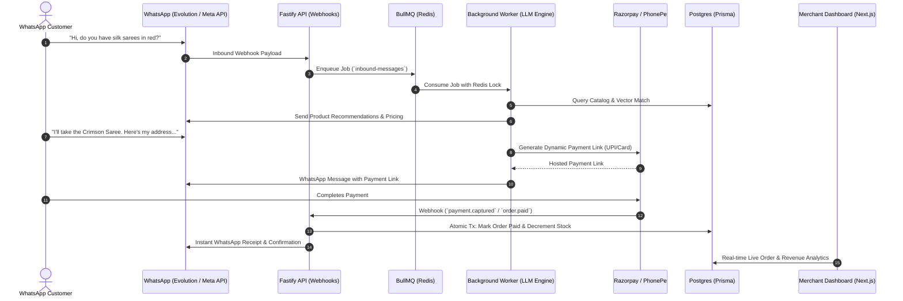

# WhatsApp Commerce OS (WCOS) 💬🛍️

> **Autonomous AI-powered WhatsApp Sales Agent & Conversational Commerce Engine for D2C Brands and Social Sellers.**

[](https://opensource.org/licenses/Apache-2.0)
[](https://github.com/JeevanRishiP/WhatsApp-AI-Sales-Agent/actions/workflows/ci.yml)
[](https://coderabbit.ai)
[](https://www.typescriptlang.org/)
[](https://turbo.build/)
[](https://nextjs.org/)
[](https://bullmq.io/)
[](https://www.prisma.io/)

---

## 🌟 Overview

**WhatsApp Commerce OS** transforms standard WhatsApp business channels into an autonomous, 24/7 sales agent. It understands customer intent, answers catalog questions, recommends products, manages shopping carts, captures delivery addresses, issues instant payment links via **Razorpay** and **PhonePe**, and updates merchant inventory in real-time.

---

## 🏗️ Architecture & Component Flow



---

## 🚀 Key Features

* **🧠 Autonomous LLM Sales Agent**: Built-in support for Ollama, Groq, and OpenAI with contextual memory, intent classification, and structured tool calling.
* **⚡ Concurrency & Distributed Locks**: Redis-backed conversation locks prevent duplicate message generation even during rapid customer messaging.
* **💳 Integrated Payment Gateways**: Production-grade support for **Razorpay** and **PhonePe** with timing-safe HMAC-SHA256 webhook signature verification.
* **📊 Multi-Tenant Merchant Dashboard**: Full-featured Next.js 15 dashboard for managing orders, conversations, customer profiles, inventory adjustments, and real-time sales analytics.
* **📦 Pnpm Monorepo with Turborepo**: Modular packages for database schema, AI gateway, payment providers, cryptography, and shared types.

---

## 📁 Repository Structure

```
.
├── apps/
│   ├── api/          # Fastify REST API & Webhook Ingestion Service
│   ├── dashboard/    # Next.js 15 Admin Portal & Merchant Analytics
│   └── worker/       # BullMQ Background Worker & LLM Orchestrator
├── packages/
│   ├── ai/           # LLM Providers (Ollama, Groq, OpenAI) & System Prompts
│   ├── crypto/       # Constant-time HMAC & AES Encryption Utilities
│   ├── db/           # Prisma ORM, Migrations & Database Seeders
│   ├── payments/     # Razorpay & PhonePe Integration Engine
│   ├── queue/        # BullMQ Connection & Job Producers
│   └── types/        # Shared TypeScript Interfaces & Enums
├── scripts/
│   └── start-all.sh  # Automated system orchestration script
└── docker-compose.yml # PostgreSQL, Redis, Evolution API setup
```

---

## 🛠️ Quick Start & Local Setup

### Prerequisites
* **Node.js** `>= 20.0.0`
* **pnpm** `>= 9.0.0`
* **Docker Desktop** (for PostgreSQL, Redis, and Evolution API)

### 1. Clone the Repository
```bash
git clone https://github.com/JeevanRishiP/WhatsApp-AI-Sales-Agent.git
cd WhatsApp-AI-Sales-Agent
```

### 2. Install Dependencies
```bash
pnpm install
```

### 3. Configure Environment Variables
Copy `.env.example` to `.env` and fill in your credentials:
```bash
cp .env.example .env
```

### 4. Database Setup
```bash
pnpm db:generate
pnpm db:push
pnpm db:seed
```

### 5. Start the Entire System
Run the all-in-one startup script (launches Docker, Redis, DB, ngrok tunnel, and dev servers):
```bash
chmod +x ./scripts/start-all.sh
./scripts/start-all.sh
```

Or run dev mode manually:
```bash
pnpm dev
```

* **Dashboard**: `http://localhost:3001`
* **API Service**: `http://localhost:3002`
* **Evolution API**: `http://localhost:8080`

---

## 📦 Container Images (GitHub Packages)

Pre-built Docker images are published to the **GitHub Container Registry (`ghcr.io`)** on every release:

```bash
# Pull API container
docker pull ghcr.io/jeevanriship/whatsapp-ai-sales-agent-api:latest

# Pull Worker container
docker pull ghcr.io/jeevanriship/whatsapp-ai-sales-agent-worker:latest
```

---

## 🛡️ License

This project is licensed under the [Apache 2.0 License](LICENSE).
