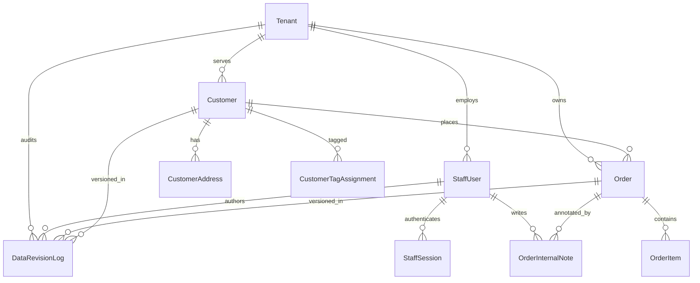
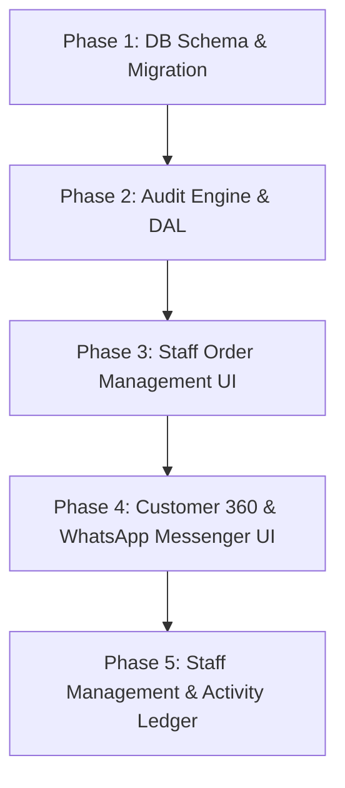

# Enterprise Staff Dashboard & Immutable Audit System Architecture

## Executive Overview
This document specifies the end-to-end design for the **Staff Operations Dashboard** and **Tamper-Evident Immutable Data Audit Trail** for **WhatsApp Commerce OS** (Aura Luxe Boutique).

The core objective is to empower team members (store managers, fulfillment staff, concierge sales agents) to execute everyday order and customer management workflows efficiently while **strictly preventing misuse, unauthorized tampering, and silent data loss**.

---

## 1. Threat Model & Anti-Misuse Guarantees

```
┌────────────────────────────────────────────────────────────────────────┐
│                        THREAT MODEL & MITIGATION                       │
├────────────────────────────┬───────────────────────────────────────────┤
│ Potential Staff Misuse     │ Technical Mitigation & Enforcement        │
├────────────────────────────┼───────────────────────────────────────────┤
│ Changing delivery address  │ Mandatory justification modal + Before/   │
│ to redirect luxury parcels │ After snapshot in append-only table       │
├────────────────────────────┼───────────────────────────────────────────┤
│ Unauthorized order status  │ Role-Based State Machine. Staff ID tied   │
│ changes (e.g. marking COD  │ to every transition with irreversible     │
│ as Paid or Cancelled)      │ event log                                 │
├────────────────────────────┼───────────────────────────────────────────┤
│ Deleting customer history  │ Hard DELETE operations strictly barred.   │
│ or orders to hide errors   │ Soft-archive only with supervisor sign-off│
├────────────────────────────┼───────────────────────────────────────────┤
│ Changing prices or line    │ Price snapshots locked at order time.     │
│ items after checkout       │ Only Managers can issue credit notes      │
├────────────────────────────┼───────────────────────────────────────────┤
│ Deniability ("Someone else │ JWT session identifies exact staff ID,    │
│ used my account")          │ IP address, user agent, and timestamp     │
└────────────────────────────┴───────────────────────────────────────────┘
```

---

## 2. Database Architecture & Schema Evolution

### 2.1 Entity Relationship Diagram



### 2.2 New & Modified Prisma Models

#### Model: `StaffUser` (Team Members & Roles)
```prisma
model StaffUser {
  id           String      @id @default(dbgenerated("gen_random_uuid()")) @db.Uuid
  tenantId     String      @db.Uuid
  fullName     String      @db.VarChar(100)
  email        String      @db.VarChar(255)
  phone        String?     @db.VarChar(20)
  passwordHash String      @db.VarChar(255)
  role         StaffRole   @default(SUPPORT_CONCIERGE)
  status       StaffStatus @default(ACTIVE)
  avatarUrl    String?
  lastLoginAt  DateTime?
  lastActiveAt DateTime?
  createdAt    DateTime    @default(now())
  updatedAt    DateTime    @updatedAt

  // Relations
  tenant        Tenant             @relation(fields: [tenantId], references: [id])
  revisions     DataRevisionLog[]
  notes         OrderInternalNote[]
  sessions      StaffSession[]

  @@unique([tenantId, email])
  @@index([tenantId, status])
  @@index([tenantId, role])
}

enum StaffRole {
  OWNER               // Super Admin: full store settings, financials, staff roster
  STORE_MANAGER       // High-level: overrides, cancellations, refunds, customer risk
  FULFILLMENT_LEAD    // Operations: courier assignments, dispatch, tracking, packing
  SUPPORT_CONCIERGE   // Frontline: customer profiles, WhatsApp queries, address updates
}

enum StaffStatus {
  ACTIVE
  SUSPENDED
  INVITED
  DEACTIVATED
}
```

#### Model: `DataRevisionLog` (Append-Only Immutable Change Ledger)
Every single change to an Order, Customer, or Address produces a row here. **No updates or deletes permitted.**
```prisma
model DataRevisionLog {
  id             String          @id @default(dbgenerated("gen_random_uuid()")) @db.Uuid
  tenantId       String          @db.Uuid
  entityType     RevisionEntity  // "ORDER" | "CUSTOMER" | "CUSTOMER_ADDRESS" | "PRODUCT"
  entityId       String          @db.Uuid
  action         RevisionAction  // "STATUS_CHANGE" | "ADDRESS_UPDATE" | "TRACKING_UPDATE" | "NOTE_ADDED" | "PROFILE_EDIT" | "ORDER_MODIFICATION"
  
  // Who made the change
  staffId        String?         @db.Uuid
  staffName      String          @db.VarChar(100)
  staffRole      StaffRole
  actorType      ActorType       @default(STAFF) // STAFF, SYSTEM, AI_AGENT, CUSTOMER
  
  // Mandatory Justification
  reason         String          @db.VarChar(500)
  
  // State Snapshots & Computed Diff
  beforeSnapshot Json            // Complete JSON state before modification
  afterSnapshot  Json            // Complete JSON state after modification
  diffSummary    Json            // e.g. {"status": {"from": "PROCESSING", "to": "SHIPPED"}}
  
  // Audit Metadata
  ipAddress      String?         @db.VarChar(45)
  userAgent      String?         @db.VarChar(255)
  timestamp      DateTime        @default(now())

  // Relations
  tenant         Tenant          @relation(fields: [tenantId], references: [id])
  staff          StaffUser?      @relation(fields: [staffId], references: [id])

  @@index([tenantId, entityType, entityId])
  @@index([tenantId, staffId])
  @@index([tenantId, timestamp(sort: Desc)])
}

enum RevisionEntity {
  ORDER
  CUSTOMER
  CUSTOMER_ADDRESS
  PRODUCT
}

enum RevisionAction {
  STATUS_CHANGE
  ADDRESS_UPDATE
  TRACKING_UPDATE
  ITEM_MODIFIED
  NOTE_ADDED
  CUSTOMER_UPDATE
  CUSTOMER_FLAGGED
  ORDER_CANCELLED
  REFUND_INITIATED
}

enum ActorType {
  STAFF
  SYSTEM
  AI_AGENT
  CUSTOMER
}
```

#### Model: `OrderInternalNote` (Threaded Non-Deletable Staff Notes)
```prisma
model OrderInternalNote {
  id        String    @id @default(dbgenerated("gen_random_uuid()")) @db.Uuid
  tenantId  String    @db.Uuid
  orderId   String    @db.Uuid
  staffId   String    @db.Uuid
  staffName String    @db.VarChar(100)
  content   String    @db.Text
  isPinned  Boolean   @default(false)
  createdAt DateTime  @default(now())

  tenant    Tenant    @relation(fields: [tenantId], references: [id])
  order     Order     @relation(fields: [orderId], references: [id])
  staff     StaffUser @relation(fields: [staffId], references: [id])

  @@index([tenantId, orderId])
}
```

#### Enhancements to `Order` & `Customer`:
- `Order`:
  - `assignedStaffId`: Assign order fulfillment or concierge to a specific staff member.
  - `riskLevel`: `LOW` | `MEDIUM` | `HIGH` (e.g. high-value cash-on-delivery or mismatched pincode).
  - `isArchived`: Boolean soft-delete flag instead of removing records.
- `Customer`:
  - `vipTier`: `STANDARD` | `SILVER` | `GOLD` | `ROYAL`
  - `tags`: String array (e.g. `["Bridal", "Silk Collector", "VIP Concierge", "Fast Payer"]`).
  - `riskStatus`: `NORMAL` | `SUSPICIOUS` | `BLOCKED`
  - `notes`: Staff notes on customer preferences.

---

## 3. Industry-Level Staff Features

```
┌────────────────────────────────────────────────────────────────────────┐
│                        FEATURE MATRIX BY ROLE                          │
├─────────────────────┬───────────┬──────────────┬─────────────┬─────────┤
│ Capability          │ Super     │ Store        │ Fulfillment │ Support │
│                     │ Admin     │ Manager      │ Lead        │ Staff   │
├─────────────────────┼───────────┼──────────────┼─────────────┼─────────┤
│ View Orders & Search│    ✅     │      ✅      │     ✅      │   ✅    │
│ Update Tracking/AWB │    ✅     │      ✅      │     ✅      │   ❌    │
│ Mark Shipped/Deliv  │    ✅     │      ✅      │     ✅      │   ❌    │
│ Edit Customer Addr  │    ✅     │      ✅      │     ✅      │   ✅*   │
│ Cancel Order        │    ✅     │      ✅      │     ❌      │   ❌    │
│ Issue Store Refund  │    ✅     │      ✅      │     ❌      │   ❌    │
│ View Audit Ledger   │    ✅     │      ✅      │  Self only  │Self only│
│ Assign Staff Member │    ✅     │      ✅      │     ❌      │   ❌    │
│ 1-Click WhatsApp Msg│    ✅     │      ✅      │     ✅      │   ✅    │
└─────────────────────┴───────────┴──────────────┴─────────────┴─────────┘
* Requires reason code and enters audit log immediately
```

### 3.1 Order Operations Hub
1. **Interactive Kanban / Status Pipelines**:
   - `Payment Pending` ➔ `Confirmed` ➔ `Packaging` ➔ `Shipped` ➔ `Delivered`
2. **Logistics & Courier Integration Bar**:
   - Courier selection: Bluedart, Delhivery, DTDC, Shiprocket, SpeedPost.
   - Live Airway Bill (AWB) generation & automatic customer notification on WhatsApp.
3. **One-Click Audit Modal (Git-Style Diff Viewer)**:
   - Click "View Audit History" on any order.
   - Shows chronological entries with staff name, role badge, timestamp, and visual red/green diff of modified fields.
4. **Mandatory Reason Protocol for Critical Actions**:
   - When a staff member modifies an address, cancels an order, or overrides a status, a prompt requires selecting or typing a reason (e.g., *"Customer WhatsApp request on Oct 29"*, *"Incorrect pincode reported by courier"*).
   - Action cannot be submitted without a valid reason.

### 3.2 Customer 360 Relationship Hub
1. **Customer Profile Card**:
   - Full identity: Name, WhatsApp verified phone, email, saved addresses.
   - Metrics: Lifetime Spend (₹), Total Orders, Return Rate, Average Order Value.
2. **Live WhatsApp Context Stream**:
   - Recent messages exchanged between the customer and the sales concierge (Meera) or AI sales agent.
3. **Direct Dispatch from Dashboard**:
   - Fast staff messaging: Send pre-approved templates or custom notifications directly to the customer's WhatsApp using the connected Evolution API.
4. **VIP & Risk Management**:
   - Assign VIP tags (`"Bridal Buyer"`, `"High Spender"`, `"Frequent Returner"`).
   - Flag suspicious customers with internal flags visible only to staff.

---

## 4. UI/UX Design System Specification

### 4.1 Visual Hierarchy & Aesthetics
- **Theme**: Luxury Atelier / Editorial Enterprise (Obsidian `#0C0C0C`, Sand Warm `#FBF9F5`, Gold Accent `#C5A880`, Card Background `#FFFFFF`, Border `#EFECE6`, Text Slate `#2D2B29`).
- **Typography**:
  - Headings: Serif (`Playfair Display` / `Cinzel` / `Newsreader`) for luxury elegance.
  - Data Tables & Metrics: Clean Sans (`Inter` / `Plus Jakarta Sans`) with tabular numbers (`font-mono` for amounts and order codes).

### 4.2 Interactive Components
1. **Slide-Over Detail Drawer (Slide-Over Inspector)**:
   - Clicking any order opens a 540px slide-over panel on the right.
   - Staff can review items, update shipping, see audit history, and write notes without leaving their filtered table view.
2. **Visual Diff Inspector**:
   ```
   [Address Update by Priya Sharma (Fulfillment)] - 10:45 AM
   Reason: "Customer requested delivery to office address via WhatsApp"
   
   - line1: "Shivaganga Nilaya, Janatha Colony"
   + line1: "Prestige Tech Park, Block C, 4th Floor"
   ```
3. **Staff Activity Status Bar**:
   - Shows active staff member avatar in top bar with role badge (`[STORE MANAGER] Jeevan Rishi`).
   - Quick switch / logout button.

---

## 5. Phased Implementation Roadmap



1. **Phase 1: Database Schema & Migration**
   - Add `StaffUser`, `DataRevisionLog`, `OrderInternalNote` models to `schema.prisma`.
   - Run `pnpm db:push` to apply changes non-destructively to PostgreSQL.
   - Seed initial default staff members (Owner, Store Manager, Concierge) for Aura Luxe Boutique.

2. **Phase 2: Audit Engine & DAL Upgrade**
   - Create `RevisionService`: automatic snapshotting, diff generation, and append-only commit to `DataRevisionLog`.
   - Update `apps/dashboard/src/lib/dal/orders.ts` and `customers.ts` to require `staffId`, `reason`, and record revisions on every write.

3. **Phase 3: Staff Order Management Hub**
   - Modernize [OrdersClient.tsx](file:///Users/jeevanriship/AI%20WhatsApp%20Sales%20Agent/apps/dashboard/src/app/(dashboard)/orders/OrdersClient.tsx).
   - Add status update with reason modal, courier tracking drawer, internal notes feed, and historical audit ledger viewer.

4. **Phase 4: Customer 360 Hub**
   - Enhance [CustomersClient.tsx](file:///Users/jeevanriship/AI%20WhatsApp%20Sales%20Agent/apps/dashboard/src/app/(dashboard)/customers/CustomersClient.tsx) and customer detail page.
   - Add address editing with audit logs, VIP tags, lifetime metrics, and direct WhatsApp template sender.

5. **Phase 5: Team & Audit Ledger Views**
   - Add `/staff` management screen for inviting/managing team members.
   - Add `/audit` log explorer for store owners to monitor all team activity in real time.

