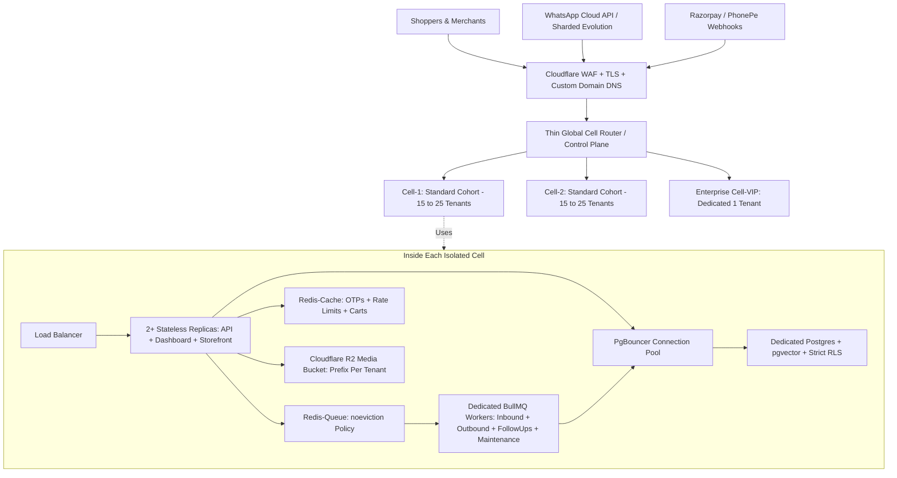

# WhatsApp Commerce OS — Master Remediation & Agency Cell-Scale Action Plan

> [!IMPORTANT]
> **Strategic Goal**: Eliminate every P0/P1 exploit and split-brain bug in a **single hardened codebase**, then deploy **Isolated Cells (Pods)** so standard merchants share high-margin infrastructure safely while high-value enterprise clients run in dedicated 1-tenant Cells — preventing any single server, Redis, or database issue from impacting the entire agency.

This action plan directly addresses every finding documented in [AGENCY_SECURITY_SCALE_AUDIT.md](file:///Users/jeevanriship/AI%20WhatsApp%20Sales%20Agent/docs/AGENCY_SECURITY_SCALE_AUDIT.md) across **5 structured sprints (Weeks 0–6)** plus deployment and verification gates.

---

## Target Architecture: Isolated Cell / Pod Topology

### Why This Solves Both Security & Uptime Blast Radius
1. **Fixes app vulnerabilities once**: Hardening the shared monorepo closes `/simulate`, `demo-login`, RBAC escalation, and webhook bypasses everywhere simultaneously — whereas cloning unpatched code to 100 servers leaves all 100 hackable via 1 script.
2. **Bounds DB & Redis outages to 1 Cell**: If `Cell-1` Postgres locks up or hits heavy traffic, `Cell-2` through `Cell-N` and Enterprise Cells remain 100% online.
3. **Zero single-server SPOF inside a Cell**: Running 2+ stateless replicas (`api`, `dashboard`, `storefront`) with R2 media means zero local disk state and automatic container failover.
4. **Enterprise tier with zero code forks**: Using identical environment-configured containers, any VIP client demanding a "separate DB and server" gets their own 1-tenant Cell instantly.

---

## Sprint 0: Emergency Security Lock-Down (Days 1–2 — Pre-Traffic Blockers)

**Objective**: Close every unauthenticated admin, payment bypass, secret fallback, CORS/rate-limit, and webhook authentication exploit immediately.

### Task 0.1 — Disable Unauthenticated Admin Auto-Login & Strip Client Credentials
* **Files**: [middleware.ts](file:///Users/jeevanriship/AI%20WhatsApp%20Sales%20Agent/apps/dashboard/src/middleware.ts#L14-L36), [demo-login/route.ts](file:///Users/jeevanriship/AI%20WhatsApp%20Sales%20Agent/apps/dashboard/src/app/api/auth/demo-login/route.ts#L13-L60), [login/page.tsx](file:///Users/jeevanriship/AI%20WhatsApp%20Sales%20Agent/apps/dashboard/src/app/login/page.tsx#L59-L368)
* **Changes**:
  * Remove or hard-gate `GET /api/auth/demo-login` behind `process.env.NODE_ENV === 'development' && process.env.ENABLE_DEMO_LOGIN === 'true'`.
  * Validate `redirectPath` strictly (`redirectPath.startsWith('/') && !redirectPath.startsWith('//')`); stop appending raw `err.message` to redirect query params.
  * Remove hardcoded `sk_live_aura_8f92jkl2309x`, `sk_live_roast_9f82kxl2390y`, `aditi@auraluxe.in`, and `'admin123'` buttons/defaults from client code in [login/page.tsx](file:///Users/jeevanriship/AI%20WhatsApp%20Sales%20Agent/apps/dashboard/src/app/login/page.tsx#L59-L367).
  * Remove the dangerous `pathname.includes('.')` bypass from [middleware.ts](file:///Users/jeevanriship/AI%20WhatsApp%20Sales%20Agent/apps/dashboard/src/middleware.ts#L33) and explicitly allow only static asset extensions under `/public` or `/_next`.

### Task 0.2 — Kill Production Payment Simulation & Outage Mock Fallbacks
* **Files**: [server.ts](file:///Users/jeevanriship/AI%20WhatsApp%20Sales%20Agent/apps/api/src/server.ts#L86-L87), [checkout.ts](file:///Users/jeevanriship/AI%20WhatsApp%20Sales%20Agent/apps/api/src/routes/payments/checkout.ts#L390-L503), [phonepe-checkout.ts](file:///Users/jeevanriship/AI%20WhatsApp%20Sales%20Agent/apps/api/src/routes/payments/phonepe-checkout.ts#L336-L451), [razorpay.ts](file:///Users/jeevanriship/AI%20WhatsApp%20Sales%20Agent/packages/payments/src/razorpay.ts#L163-L210), [phonepe.ts](file:///Users/jeevanriship/AI%20WhatsApp%20Sales%20Agent/packages/payments/src/phonepe.ts#L203-L242), [actions/orders.ts](file:///Users/jeevanriship/AI%20WhatsApp%20Sales%20Agent/apps/dashboard/src/lib/actions/orders.ts#L246-L276)
* **Changes**:
  * Mount `checkoutPaymentRoutes` and `phonePeCheckoutRoutes` **only** when `config.NODE_ENV !== 'production' && process.env['ENABLE_PAYMENT_SIMULATOR'] === 'true'`.
  * Remove the outage fallback to `isSandboxMock: true` inside `RazorpayService.createPaymentLink` and `PhonePeService.createPaymentLink` when live credentials are configured; throw a typed `PaymentGatewayUnavailableError` so checkout retries or fails safely rather than handing customers a free simulator link.
  * In [`simulateRazorpayPaymentAction`](file:///Users/jeevanriship/AI%20WhatsApp%20Sales%20Agent/apps/dashboard/src/lib/actions/orders.ts#L246-L341), reject immediately in production, check `OWNER`/`STORE_MANAGER` role, and verify `tenantId` *before* calling any API.

### Task 0.3 — Fail-Closed Secrets & Env Schema Alignment
* **Files**: [.env.example](file:///Users/jeevanriship/AI%20WhatsApp%20Sales%20Agent/.env.example#L34-L64), [apps/api/src/config.ts](file:///Users/jeevanriship/AI%20WhatsApp%20Sales%20Agent/apps/api/src/config.ts#L16-L24), [apps/worker/src/config.ts](file:///Users/jeevanriship/AI%20WhatsApp%20Sales%20Agent/apps/worker/src/config.ts#L13-L19), [apps/dashboard/src/lib/auth.ts](file:///Users/jeevanriship/AI%20WhatsApp%20Sales%20Agent/apps/dashboard/src/lib/auth.ts#L17-L20), [payment-notifications.ts](file:///Users/jeevanriship/AI%20WhatsApp%20Sales%20Agent/apps/api/src/services/payment-notifications.ts#L67-L69), [razorpay.ts webhook](file:///Users/jeevanriship/AI%20WhatsApp%20Sales%20Agent/apps/api/src/routes/webhooks/razorpay.ts#L30), [phonepe.ts webhook](file:///Users/jeevanriship/AI%20WhatsApp%20Sales%20Agent/apps/api/src/routes/webhooks/phonepe.ts#L19)
* **Changes**:
  * Standardize env variable names across `.env.example`, `api`, `worker`, and `dashboard` (`ENCRYPTION_MASTER_KEY`, `EVOLUTION_API_GLOBAL_KEY`, `ADMIN_API_KEY`, `JWT_SECRET`, `GEMINI_API_KEY`, `RAZORPAY_WEBHOOK_SECRET`, `PHONEPE_SALT_KEY`).
  * Eliminate **every** hardcoded secret fallback string when `NODE_ENV === 'production'`; crash fast at boot if any secret is missing or shorter than minimum entropy length (e.g., `JWT_SECRET.length >= 32`, `ENCRYPTION_MASTER_KEY.length === 64`).

### Task 0.4 — Lock Down CORS, Rate Limiting & Dashboard Auth Error Codes
* **Files**: [server.ts](file:///Users/jeevanriship/AI%20WhatsApp%20Sales%20Agent/apps/api/src/server.ts#L26-L63), [handoff/status/route.ts](file:///Users/jeevanriship/AI%20WhatsApp%20Sales%20Agent/apps/dashboard/src/app/api/handoff/status/route.ts#L8-L66), [ai-agent-toggle/route.ts](file:///Users/jeevanriship/AI%20WhatsApp%20Sales%20Agent/apps/dashboard/src/app/api/settings/ai-agent-toggle/route.ts#L10-L61)
* **Changes**:
  * Replace `origin: (_origin, cb) => cb(null, true)` with an explicit async origin validator checking `ALLOWED_ORIGINS` env plus active `Tenant.customDomain` hosts cached in Redis.
  * Attach `@fastify/rate-limit` to the dedicated cache Redis client, remove `'127.0.0.1'` / `'::1'` / `'localhost'` `allowList` in production, and configure `trustProxy` strictly to the trusted CIDR/hop count of your load balancer. Tighten rate limits specifically on `/api/v1/customer/auth/send-otp`, `/verify-otp`, and `/track/:query`.
  * Use `verifySession()` instead of `getSession()` inside Next.js Route Handlers so unauthenticated API requests cleanly return HTTP `401` instead of catching `NEXT_REDIRECT` as HTTP `500`.

### Task 0.5 — Mandatory Webhook Auth & Fix Cross-Tenant Public Track IDOR
* **Files**: [webhooks/evolution.ts](file:///Users/jeevanriship/AI%20WhatsApp%20Sales%20Agent/apps/api/src/routes/webhooks/evolution.ts#L19-L171), [webhooks/meta.ts](file:///Users/jeevanriship/AI%20WhatsApp%20Sales%20Agent/apps/api/src/routes/webhooks/meta.ts#L27-L85), [deduplication.ts](file:///Users/jeevanriship/AI%20WhatsApp%20Sales%20Agent/apps/api/src/middleware/deduplication.ts#L13-L15), [customer/orders.ts](file:///Users/jeevanriship/AI%20WhatsApp%20Sales%20Agent/apps/api/src/routes/customer/orders.ts#L490-L525)
* **Changes**:
  * In `evolutionWebhookRoutes`: require a valid `apikey`/`x-api-key` or per-tenant webhook token **unconditionally** (reject missing headers with `401`), remove `'aura_luxe_secret_token_123'`, verify referenced `:tenantId` exists and `status === 'ACTIVE'` before DB writes, and fail closed (`return false` or fallback deterministic hash) if `providerMessageId` is missing in `deduplication.ts`.
  * In `metaWebhookRoutes`: require valid `X-Hub-Signature-256` HMAC unconditionally, loop through **all** `entry[] -> changes[] -> value.messages[]`, validate `phone_number_id` belongs to `:tenantId` (`Tenant.status === 'ACTIVE'`), and remove default `'wcos-meta-verify-token'`.
  * In `GET /api/v1/customer/track/:query`: fail immediately with `404 StoreNotFound` if `CustomerAuthService.resolveTenant(tenantSlug)` throws — **never** drop `tenantId` from the `prisma.order.findFirst` `where` clause.

---

## Sprint 1: Identity, RBAC & Per-Tenant Secret Vault (Days 3–7)

**Objective**: Enforce strict role permissions, fix staff authentication, harden OTP/magic links, and activate HKDF per-tenant encryption.

### Task 1.1 — Enforce RBAC Matrix & Fix Staff Authentication
* **Files**: [lib/auth.ts](file:///Users/jeevanriship/AI%20WhatsApp%20Sales%20Agent/apps/dashboard/src/lib/auth.ts#L24-L116), [actions/team.ts](file:///Users/jeevanriship/AI%20WhatsApp%20Sales%20Agent/apps/dashboard/src/lib/actions/team.ts#L155-L185), [dal/team.ts](file:///Users/jeevanriship/AI%20WhatsApp%20Sales%20Agent/apps/dashboard/src/lib/dal/team.ts#L25-L69), [team/page.tsx](file:///Users/jeevanriship/AI%20WhatsApp%20Sales%20Agent/apps/dashboard/src/app/(dashboard)/team/page.tsx#L29-L36), [actions/auth.ts](file:///Users/jeevanriship/AI%20WhatsApp%20Sales%20Agent/apps/dashboard/src/lib/actions/auth.ts#L32-L136), [actions/settings.ts](file:///Users/jeevanriship/AI%20WhatsApp%20Sales%20Agent/apps/dashboard/src/lib/actions/settings.ts#L37-L268), [actions/products.ts](file:///Users/jeevanriship/AI%20WhatsApp%20Sales%20Agent/apps/dashboard/src/lib/actions/products.ts#L208-L438), [actions/orders.ts](file:///Users/jeevanriship/AI%20WhatsApp%20Sales%20Agent/apps/dashboard/src/lib/actions/orders.ts#L44-L242), [payments/export/route.ts](file:///Users/jeevanriship/AI%20WhatsApp%20Sales%20Agent/apps/dashboard/src/app/api/payments/export/route.ts#L10-L16), [stock-adjust/route.ts](file:///Users/jeevanriship/AI%20WhatsApp%20Sales%20Agent/apps/dashboard/src/app/api/inventory/stock-adjust/route.ts#L26-L32), [photos/route.ts](file:///Users/jeevanriship/AI%20WhatsApp%20Sales%20Agent/apps/dashboard/src/app/api/inventory/[id]/photos/route.ts#L34-L220), [dal/settings.ts](file:///Users/jeevanriship/AI%20WhatsApp%20Sales%20Agent/apps/dashboard/src/lib/dal/settings.ts#L219-L260)
* **Changes**:
  * Add `requireRole(session, allowedRoles: StaffRole[])` helper and apply consistently:
    * `OWNER` only: team invites/roles, password changes on owner account, billing/API keys, payment/gateway credentials, WhatsApp connection settings, `/api/payments/export` (or `OWNER`/`STORE_MANAGER`).
    * `OWNER` + `STORE_MANAGER`: products/inventory/photos/CSV imports, AI config, order status/cancellations/refunds.
    * `FULFILLMENT_LEAD`: tracking/AWB/packing updates, stock counts (scoped).
    * `SUPPORT_CONCIERGE`: conversations, handoff resolution, internal notes.
  * Delete or dev-gate `switchActiveStaffAction`, and enforce `where: { id: staffId, tenantId: session.tenantId }` on both `switchActiveStaffAction` and `assignStaffAction`.
  * Add explicit `select` in `listTeamMembers` omitting `passwordHash`; never pass `tenant.apiKey` to non-`OWNER` UI views.
  * Fix `StaffUser` login: invite flow generates an expiring password-setup token rather than `$2a$10$demoDefaultPasswordHashForStaff2026`, `loginAction` checks `StaffUser` (scoped by tenant slug or email + `bcrypt.compare`) as well as `Tenant` owner, and checks `StaffUser.status === 'ACTIVE'` on login and inside `verifySession`.

### Task 1.2 — Harden Customer OTP, Magic Links & Session Revocation
* **Files**: [customer-auth-service.ts](file:///Users/jeevanriship/AI%20WhatsApp%20Sales%20Agent/apps/api/src/services/customer-auth-service.ts#L40-L348), [customer-auth.ts](file:///Users/jeevanriship/AI%20WhatsApp%20Sales%20Agent/apps/api/src/middleware/customer-auth.ts#L13-L52), [customer/auth.ts](file:///Users/jeevanriship/AI%20WhatsApp%20Sales%20Agent/apps/api/src/routes/customer/auth.ts#L53-L89), [checkout/page.tsx](file:///Users/jeevanriship/AI%20WhatsApp%20Sales%20Agent/apps/storefront/src/app/[storeSlug]/checkout/page.tsx#L106-L117)
* **Changes**:
  * Compute OTP hash using HMAC-SHA256 keyed with server secret, execute attempt increment + lockout atomically in a **Redis Lua script**, and compare digests with `timingSafeCompare`.
  * Remove production OTP console logging (`NODE_ENV !== 'production'` only — never `!dispatched` in prod).
  * Include a unique `jti` claim in `createMagicLinkToken` backed by `magic:{jti}` in Redis (`GETDEL` / `DEL`) so links are strictly **single-use**; verify `Tenant.status === 'ACTIVE'` and `Customer.riskStatus !== 'BLOCKED'` inside `resolveMagicLinkToken`, `verifyOtp`, `resolveTenant`, and `requireCustomerAuth`.
  * Set `Secure` (when HTTPS/prod) on `wcos_customer_token`, and include `Authorization: Bearer` in `checkout/page.tsx` submit request.

### Task 1.3 — Activate Per-Tenant HKDF Encrypted Credential Vault
* **Files**: [schema.prisma](file:///Users/jeevanriship/AI%20WhatsApp%20Sales%20Agent/packages/db/prisma/schema.prisma#L27-L71), [encryption.ts](file:///Users/jeevanriship/AI%20WhatsApp%20Sales%20Agent/packages/crypto/src/encryption.ts#L11-L90), [SettingsClient.tsx](file:///Users/jeevanriship/AI%20WhatsApp%20Sales%20Agent/apps/dashboard/src/app/(dashboard)/settings/SettingsClient.tsx#L294-L334,L1455-L1478)
* **Changes**:
  * Store per-tenant Razorpay (`keyId`, `keySecret`, `webhookSecret`), PhonePe (`merchantId`, `saltKey`, `saltIndex`, `env`), Evolution/Meta (`accessToken`, `appSecret`, `phoneNumberId`, `webhookSecret`), and BYOK AI keys encrypted via `encryptJSON(payload, deriveTenantKey(ENCRYPTION_MASTER_KEY, tenantId))`.
  * Remove `'rzp_test_sample'` and `'wcos-razorpay-secret'` from `SettingsClient.tsx`; display masked hints (`rzp_live_****8a2f`), and implement real `/api/payments/phonepe/test-connection` probe instead of fake `{ success: true }` fallback.

---

## Sprint 2: Financial Integrity, Webhooks & Unified Order/Inventory Engine (Week 2)

**Objective**: Eliminate double-decrements, status regressions, split-brain carts, stuck inventory reservations, and dead worker modules.

### Task 2.1 — Atomic Gateway Webhooks with Per-Tenant Secrets & Amount Checks
* **Files**: [webhooks/razorpay.ts](file:///Users/jeevanriship/AI%20WhatsApp%20Sales%20Agent/apps/api/src/routes/webhooks/razorpay.ts#L22-L173), [webhooks/phonepe.ts](file:///Users/jeevanriship/AI%20WhatsApp%20Sales%20Agent/apps/api/src/routes/webhooks/phonepe.ts#L7-L185), [razorpay.ts](file:///Users/jeevanriship/AI%20WhatsApp%20Sales%20Agent/packages/payments/src/razorpay.ts), [phonepe.ts](file:///Users/jeevanriship/AI%20WhatsApp%20Sales%20Agent/packages/payments/src/phonepe.ts)
* **Changes**:
  * Refactor `RazorpayService` and `PhonePeService` from global env singletons into factory/per-tenant instances initialized from decrypted tenant credentials.
  * Use `timingSafeCompare` in `verifyPhonePeChecksum`.
  * Strictly verify `amountPaid >= Math.round(Number(order.total) * 100)`, matching `currency`, and exact terminal success state (`status === 'PAYMENT_SUCCESS' || status === 'COMPLETED'` — remove loose `decoded?.success === true` shortcut).
  * Inside `prisma.$transaction`, execute atomic compare-and-set (`updateMany({ where: { id: order.id, tenantId, status: 'PENDING_PAYMENT' }, data: { status: 'PAYMENT_CONFIRMED', ... } })`). Only if `count === 1` should inventory commit (`stock: decrement`, `reserved: decrement`), `OutboxEvent` creation, `Conversation.stage = 'POST_ORDER'` reset, and `notifyOrderPaymentConfirmed` proceed — preventing concurrent duplicates and order status regressions.

### Task 2.2 — Unified Cart, Checkout, Stock Reservation & Atomic Adjustments
* **Files**: [customer/cart.ts](file:///Users/jeevanriship/AI%20WhatsApp%20Sales%20Agent/apps/api/src/routes/customer/cart.ts#L11-L231), [packages/queue/src/cart-service.ts](file:///Users/jeevanriship/AI%20WhatsApp%20Sales%20Agent/packages/queue/src/cart-service.ts#L13-L235), [customer/orders.ts](file:///Users/jeevanriship/AI%20WhatsApp%20Sales%20Agent/apps/api/src/routes/customer/orders.ts#L313-L481), [execution-engine.ts](file:///Users/jeevanriship/AI%20WhatsApp%20Sales%20Agent/apps/worker/src/tools/execution-engine.ts#L311-L520,L1110-L1242), [dal/orders.ts](file:///Users/jeevanriship/AI%20WhatsApp%20Sales%20Agent/apps/dashboard/src/lib/dal/orders.ts#L189-L217), [stock-adjust/route.ts](file:///Users/jeevanriship/AI%20WhatsApp%20Sales%20Agent/apps/dashboard/src/app/api/inventory/stock-adjust/route.ts#L50-L127)
* **Changes**:
  * In `resolveCartContext`: if authenticated, require `tenant.id === request.customerSession.tenantId` (`403` on mismatch). For guests, isolate Redis keys cleanly (`cart:web:{tenantId}:guest:{sha256(guestId)}`) and block guest access to `channel='wa'` and `/cart/merge`.
  * Validate cart quantities strictly with Zod (`z.number().int().min(1).max(20)`) and check cumulative cart qty against live `stock - reserved`.
  * Unify WhatsApp and Web cart state on one shared persistence contract and build a single **Transactional Checkout Service**:
    * Re-read live DB `Product` price, `salePrice`, `ACTIVE` status, and stock inside `$transaction`.
    * Apply tenant-configured shipping rules consistently across WA & Web.
    * Atomically reserve stock with `UPDATE "Product" SET reserved = reserved + $qty WHERE id = $id AND (stock - reserved) >= $qty`, insert an `InventoryReservation` (15m TTL), and **always bind `Order.reservationId`**.
    * Generate collision-proof order numbers (tenant sequence or `ORD-${yyyymmdd}-${cryptoRandomBase32(6)}`) rather than `count + 1001` or `Date.now()`.
    * Clear cart only on confirmed COD / after order+payment-link generation, and return a real Razorpay/PhonePe URL for web `*_ONLINE` orders.
  * Fix `UPDATE_CART_QUANTITY` in `execution-engine.ts` (`Number(action.quantity ?? 1)` instead of `|| 1`) so `0` cleanly removes items; release `InventoryReservation` / restore `stock`/`reserved` on order cancellation.
  * Make `POST /api/inventory/stock-adjust` aggregate duplicate `productId` deltas, use atomic SQL conditional decrements (`stock: { increment: delta }` where `stock + delta >= 0`), and persist `AuditLog` inside the same `$transaction`.

### Task 2.3 — Consolidate Dead Worker Code & Schedule Cron Maintenance
* **Files**: [apps/worker/src/index.ts](file:///Users/jeevanriship/AI%20WhatsApp%20Sales%20Agent/apps/worker/src/index.ts#L9-L33), [workers/inbound-worker.ts](file:///Users/jeevanriship/AI%20WhatsApp%20Sales%20Agent/apps/worker/src/workers/inbound-worker.ts), [processors/inbound.ts](file:///Users/jeevanriship/AI%20WhatsApp%20Sales%20Agent/apps/worker/src/processors/inbound.ts#L63-L125), [processors/follow-up.ts](file:///Users/jeevanriship/AI%20WhatsApp%20Sales%20Agent/apps/worker/src/processors/follow-up.ts), [cron/maintenance.ts](file:///Users/jeevanriship/AI%20WhatsApp%20Sales%20Agent/apps/worker/src/cron/maintenance.ts#L9-L95)
* **Changes**:
  * Port the pre-LLM DB-level `AWAITING_PAYMENT` fraud guard and `AuditLog` entry from orphaned `processors/inbound.ts` into live `inbound-worker.ts`, then delete the redundant duplicate files (`processors/inbound.ts`, unused `apps/worker/src/cart/cart-service.ts`).
  * Register the `QUEUE_NAMES.FOLLOW_UPS` BullMQ `Worker` cleanly in `apps/worker/src/index.ts`.
  * Run `cleanupExpiredReservations` (every 60s via BullMQ repeatable job with `SELECT ... FOR UPDATE SKIP LOCKED`) and `processOutboxBatch` (every 10s with real dispatcher + dead-letter threshold).

---

## Sprint 3: White-Label Multi-Tenancy, PostgreSQL RLS & AppSec Hardening (Week 3)

**Objective**: Remove all hardcoded single-brand "Aura Luxe" leakage, add DB-enforced multi-tenant isolation, and close remaining AppSec/crash bugs.

### Task 3.1 — Remove Hardcoded Brand Defaults & Fix Custom Domain Routing
* **Files**: [schema.prisma](file:///Users/jeevanriship/AI%20WhatsApp%20Sales%20Agent/packages/db/prisma/schema.prisma#L27-L71), [store-service.ts](file:///Users/jeevanriship/AI%20WhatsApp%20Sales%20Agent/apps/storefront/src/lib/store-service.ts#L77-L287), [products/[id]/page.tsx](file:///Users/jeevanriship/AI%20WhatsApp%20Sales%20Agent/apps/storefront/src/app/[storeSlug]/products/[id]/page.tsx#L44-L180), [OrderBillClient.tsx](file:///Users/jeevanriship/AI%20WhatsApp%20Sales%20Agent/apps/dashboard/src/app/(dashboard)/orders/[id]/bill/OrderBillClient.tsx#L228-L450), [logistics-service.ts](file:///Users/jeevanriship/AI%20WhatsApp%20Sales%20Agent/apps/dashboard/src/lib/shipping/logistics-service.ts#L169-L220), [context-builder.ts](file:///Users/jeevanriship/AI%20WhatsApp%20Sales%20Agent/apps/worker/src/orchestrator/context-builder.ts#L231-L349), [gateway.ts](file:///Users/jeevanriship/AI%20WhatsApp%20Sales%20Agent/packages/ai/src/gateway.ts#L174-L190), [system-prompt.ts](file:///Users/jeevanriship/AI%20WhatsApp%20Sales%20Agent/packages/ai/src/prompts/system-prompt.ts#L229-L250), [apps/storefront/src/middleware.ts](file:///Users/jeevanriship/AI%20WhatsApp%20Sales%20Agent/apps/storefront/src/middleware.ts#L12-L27)
* **Changes**:
  * Add per-tenant legal/invoice/brand settings (`legalName`, `gstin`, `cin`, `warehouseAddress`, `supportPhone`, `defaultHsn`, `returnPolicy`, `botPersonaName`) to `Tenant` + dashboard Settings UI.
  * Replace all Aura Luxe fallbacks in `store-service.ts`, `CustomerAuthService.resolveTenant`, `OrderBillClient.tsx`, `logistics-service.ts`, `context-builder.ts` (unify `persona.botName || persona.agentName`), `system-prompt.ts`, `gateway.ts`, `inbound-worker.ts`, `outbound-worker.ts`, and `payment-notifications.ts` with tenant-configured fields or clean 404 / empty-catalog states.
  * Update `apps/storefront/src/middleware.ts` to resolve `Tenant.customDomain` -> `tenant.slug` via cached API/Redis lookup instead of `hostname.split('.')[0]`.
  * Gate simulated Delhivery AWB tracking behind sandbox env and wire real carrier API client when live credentials are configured.

### Task 3.2 — Unique Routing Constraints & PostgreSQL Row-Level Security (RLS)
* **Files**: [packages/db/prisma/schema.prisma](file:///Users/jeevanriship/AI%20WhatsApp%20Sales%20Agent/packages/db/prisma/schema.prisma#L39-L70), [packages/db/src/client.ts](file:///Users/jeevanriship/AI%20WhatsApp%20Sales%20Agent/packages/db/src/client.ts#L14-L26), [admin/tenants.ts](file:///Users/jeevanriship/AI%20WhatsApp%20Sales%20Agent/apps/api/src/routes/admin/tenants.ts#L54-L99)
* **Changes**:
  * Add `@unique` constraints on `Tenant.whatsappInstanceName` and normalized `Tenant.whatsappPhoneNumber` (after cleaning any duplicates) and handle `P2002` cleanly in dashboard & admin routes; redact `passwordHash` and `apiKey` from `tenantAdminRoutes` responses.
  * Add SQL migration enabling **PostgreSQL Row-Level Security (RLS)** on all tenant-scoped tables (`Product`, `Order`, `OrderItem`, `InventoryReservation`, `Conversation`, `Message`, `CustomerMemory`, `Customer`, `CustomerAddress`, `AuditLog`, `OutboxEvent`, `StaffUser`, `DataRevisionLog`, `OrderInternalNote`) using `tenant_id = NULLIF(current_setting('app.current_tenant_id', true), '')::uuid` enforced under a non-superuser app role (`WITH CHECK` + `USING`), wrapped in a Prisma helper `withTenantContext(tenantId, fn)`.

### Task 3.3 — AppSec & Reliability Fixes (XSS, Traversal, CSV, IDOR, Regex Crash, UUIDs)
* **Files**: [checkout.ts](file:///Users/jeevanriship/AI%20WhatsApp%20Sales%20Agent/apps/api/src/routes/payments/checkout.ts#L82-L356), [phonepe-checkout.ts](file:///Users/jeevanriship/AI%20WhatsApp%20Sales%20Agent/apps/api/src/routes/payments/phonepe-checkout.ts#L64-L309), [webhooks/phonepe.ts](file:///Users/jeevanriship/AI%20WhatsApp%20Sales%20Agent/apps/api/src/routes/webhooks/phonepe.ts#L233), [media/[...path]/route.ts](file:///Users/jeevanriship/AI%20WhatsApp%20Sales%20Agent/apps/dashboard/src/app/api/media/%5B...path%5D/route.ts#L19-L51), [photos/route.ts](file:///Users/jeevanriship/AI%20WhatsApp%20Sales%20Agent/apps/dashboard/src/app/api/inventory/[id]/photos/route.ts#L210-L216), [payments/export/route.ts](file:///Users/jeevanriship/AI%20WhatsApp%20Sales%20Agent/apps/dashboard/src/app/api/payments/export/route.ts#L36-L111), [actions/products.ts](file:///Users/jeevanriship/AI%20WhatsApp%20Sales%20Agent/apps/dashboard/src/lib/actions/products.ts#L222-L261), [address-matcher.ts](file:///Users/jeevanriship/AI%20WhatsApp%20Sales%20Agent/packages/ai/src/address-matcher.ts#L267), [execution-engine.ts](file:///Users/jeevanriship/AI%20WhatsApp%20Sales%20Agent/apps/worker/src/tools/execution-engine.ts#L1280-L1292), [customer/storefront.ts](file:///Users/jeevanriship/AI%20WhatsApp%20Sales%20Agent/apps/api/src/routes/customer/storefront.ts#L154-L159), [store-service.ts](file:///Users/jeevanriship/AI%20WhatsApp%20Sales%20Agent/apps/storefront/src/lib/store-service.ts#L156-L256), [customer/addresses.ts](file:///Users/jeevanriship/AI%20WhatsApp%20Sales%20Agent/apps/api/src/routes/customer/addresses.ts#L152-L267)
* **Changes**:
  * Add strict HTML-entity encoding (`escapeHtml`) for all HTML templates and `JSON.stringify` for inline `<script>` values in payment routes.
  * Fix path traversal prefix check (`filePath.startsWith(baseDir + path.sep)`), remove/sandbox `.svg` MIME delivery (`Content-Security-Policy: sandbox` + `X-Content-Type-Options: nosniff`), and validate URLs in `PATCH /photos` with `https:`/`/uploads/` allowlist.
  * Prefix CSV cells starting with `=`, `+`, `-`, `@`, `\t`, `\r` with `'` in `payments/export`, fix `'COD'` enum filter, validate `dateFrom`/`dateTo`, and switch `bulkImportProductsAction` to `csv-parse/sync`.
  * Scope bot `ORDER_STATUS` queries to `customerPhone: { in: phoneVariants }`.
  * Replace all `.length === 36` checks with strict `UUID_V4_REGEX` + Fastify/Zod param schemas across every route.
  * Escape regex metacharacters in `matchSavedAddressSelection`; fix `store-service.ts` `where.AND` combination for `category + search`; require `status: 'ACTIVE'` on single-product endpoints; merge (never overwrite) `CustomerMemory.preferredAttributes` and sync default address edits/deletes.

---

## Sprint 4: Horizontal Scale, AI/Search Optimization & Multi-Cell Automation (Weeks 4–6)

**Objective**: Remove all performance ceilings, separate volatile cache from queue Redis, enforce plan quotas, and automate Cell provisioning.

### Task 4.1 — Split Redis, Isolate BullMQ Connections & Add Tenant Fairness
* **Files**: [docker-compose.yml](file:///Users/jeevanriship/AI%20WhatsApp%20Sales%20Agent/docker-compose.yml#L77-L96), [packages/queue/src/connection.ts](file:///Users/jeevanriship/AI%20WhatsApp%20Sales%20Agent/packages/queue/src/connection.ts#L17-L49), [inbound-worker.ts](file:///Users/jeevanriship/AI%20WhatsApp%20Sales%20Agent/apps/worker/src/workers/inbound-worker.ts#L47-L53,L300-L303)
* **Changes**:
  * Run two dedicated Redis roles: `REDIS_QUEUE_URL` with `--maxmemory-policy noeviction` (BullMQ + `ConversationLock`) and `REDIS_CACHE_URL` (`volatile-lru` / sufficient memory for OTP, rate limits, carts).
  * Give each BullMQ `Worker` its own connection (`connection.duplicate()` or dedicated pool) and enable strict TLS certificate verification (`rejectUnauthorized: true` with proper CA bundle).
  * Reject jobs early when `tenant.status !== 'ACTIVE'`, atomically meter & enforce `Tenant.monthlyMessageCount < Tenant.monthlyMessageLimit`, and apply per-tenant concurrency throttling (fair semaphore/token bucket in Redis) so 1 merchant spike cannot starve others.

### Task 4.2 — Fix LLM Defaults, BYOK Routing, Timeouts & `pgvector` Search
* **Files**: [packages/ai/src/providers.ts](file:///Users/jeevanriship/AI%20WhatsApp%20Sales%20Agent/packages/ai/src/providers.ts#L52-L122), [packages/ai/src/gateway.ts](file:///Users/jeevanriship/AI%20WhatsApp%20Sales%20Agent/packages/ai/src/gateway.ts#L101-L106), [inbound-worker.ts](file:///Users/jeevanriship/AI%20WhatsApp%20Sales%20Agent/apps/worker/src/workers/inbound-worker.ts#L12,L192-L198), [context-builder.ts](file:///Users/jeevanriship/AI%20WhatsApp%20Sales%20Agent/apps/worker/src/orchestrator/context-builder.ts#L175-L195), [execution-engine.ts](file:///Users/jeevanriship/AI%20WhatsApp%20Sales%20Agent/apps/worker/src/tools/execution-engine.ts#L33-L43,L187-L212)
* **Changes**:
  * Replace invalid default Gemini IDs (`gemini-3.5-flash` etc.) with current valid Gemini models, resolve decrypted per-tenant BYOK `ProviderKeys` dynamically per request inside `AIGateway`, and attach `AbortSignal.timeout(15_000)` to `generateText` (matching `ConversationLock` 20s wait window cleanly).
  * Compute & store `Product.embedding` on product mutations/imports, add a `pgvector` HNSW index + `pg_trgm` / `tsvector` GIN index, and replace full-table `findMany` fallbacks in `findProductByCode` and `ILIKE` loops with indexed normalized-SKU lookup (`codeNormalized` indexed column) + hybrid vector/FTS queries.

### Task 4.3 — R2 Media Storage, Real-Time Dashboard Push & DB Lifecycle
* **Files**: [photos/route.ts](file:///Users/jeevanriship/AI%20WhatsApp%20Sales%20Agent/apps/dashboard/src/app/api/inventory/[id]/photos/route.ts#L77-L95), [actions/products.ts](file:///Users/jeevanriship/AI%20WhatsApp%20Sales%20Agent/apps/dashboard/src/lib/actions/products.ts#L331-L343), [HumanHandoffStickyBanner.tsx](file:///Users/jeevanriship/AI%20WhatsApp%20Sales%20Agent/apps/dashboard/src/components/HumanHandoffStickyBanner.tsx#L80-L114), [ConversationsClient.tsx](file:///Users/jeevanriship/AI%20WhatsApp%20Sales%20Agent/apps/dashboard/src/app/(dashboard)/conversations/ConversationsClient.tsx#L168-L177), [admin/products.ts](file:///Users/jeevanriship/AI%20WhatsApp%20Sales%20Agent/apps/api/src/routes/admin/products.ts#L194), [packages/db/src/client.ts](file:///Users/jeevanriship/AI%20WhatsApp%20Sales%20Agent/packages/db/src/client.ts#L14-L21)
* **Changes**:
  * Replace local disk `public/uploads/products` writes with Cloudflare R2 / S3 presigned URLs (`tenants/{tenantId}/products/{uuid}.{ext}`) served via CDN.
  * Replace 4s `router.refresh()` & 5s handoff polling with lightweight **SSE / WebSocket** endpoints pushed from Redis Pub/Sub events emitted by `inbound-worker.ts`.
  * Batch CSV upserts inside chunked transactions, configure Prisma PgBouncer limits (`?pgbouncer=true&connection_limit=...`), add monthly Postgres partitioning or scheduled retention archival for `RawWebhookEvent`, `Message`, and `AuditLog`, and add soft-delete + cleanup workflows for tenant offboarding.

### Task 4.4 — Multi-Cell Container Hardening & Deployment Automation
* **Files**: [Dockerfile.api](file:///Users/jeevanriship/AI%20WhatsApp%20Sales%20Agent/Dockerfile.api), [Dockerfile.worker](file:///Users/jeevanriship/AI%20WhatsApp%20Sales%20Agent/Dockerfile.worker), plus new `Dockerfile.dashboard`, `Dockerfile.storefront`, `docker-compose.cell.yml`, and Cell Routing config
* **Changes**:
  * Harden `Dockerfile.api` & `Dockerfile.worker` (and add `Dockerfile.dashboard`, `Dockerfile.storefront`) with non-root `USER node`, pruned production `pnpm deploy` artifacts, and HTTP/process `HEALTHCHECK`s.
  * Package a parameterized **Cell stack template** (PgBouncer + Postgres/Supabase project + `Redis-Queue` + `Redis-Cache` + 2x `api`, `dashboard`, `storefront`, N x `worker`, sharded Evolution / Meta Cloud routing) plus a tiny **Cell Registry** routing `customDomain`, `slug`, and webhook URLs to each Cell.
  * Prefer **Meta Official WhatsApp Cloud API** (`metaWebhookRoutes`) for agency production tenants (zero Baileys RAM leaks/ban fragility) while isolating Evolution API instances into bounded shards (20–50 sessions max per Evolution pod).

---

## Pre-Launch Verification & Release Gates

Do not onboard paying agency merchants until **all** automated checks below pass against staging:

1. **Security & Auth Penetration Suite**:
   * Unauthenticated `GET /api/auth/demo-login`, `POST /payments/checkout/:id/simulate`, and unsigned `/webhooks/*` must return `401`/`404` in `NODE_ENV=production`.
   * Low-privilege role (`SUPPORT_CONCIERGE`) invoking owner/manager actions (`changePasswordAction`, `switchActiveStaffAction`, `updateAiConfigAction`, `/api/payments/export`, `/api/inventory/stock-adjust`) must return `403`.
   * Cross-tenant probes (`/api/v1/customer/cart` with mismatched `x-tenant-slug`, `/api/v1/customer/track/:query` with invalid slug, Evolution/Meta webhook spoofing) must fail closed (`403`/`404`/`401`), confirmed by both app layer and Postgres RLS errors.
2. **Concurrency & Financial Correctness Suite**:
   * Firing `Promise.all` of 10 identical signed Razorpay/PhonePe webhooks results in **exactly 1** `PAYMENT_CONFIRMED` transition, **1** stock decrement, **1** `OutboxEvent`, and **1** WhatsApp confirmation.
   * Paying less than `order.total` fails verification cleanly; cancelled or expired reservations release `Product.reserved` automatically within 60 seconds.
3. **Cell Isolation & Load Test**:
   * Flooding `Cell-1` webhook endpoint with 500 req/s verifies **0% latency degradation on `Cell-2`** and **zero evicted BullMQ/lock keys** in Redis (`evicted_keys === 0`).

