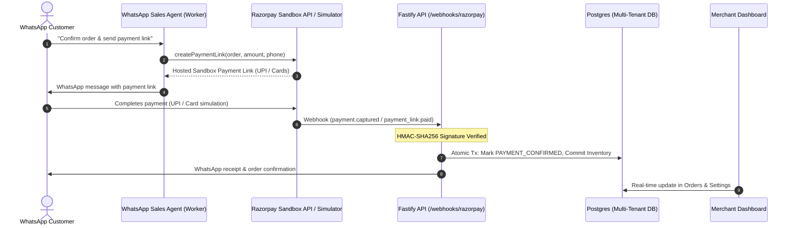

# 💳 Razorpay Sandbox Payment Gateway Integration

WhatsApp Commerce OS has been upgraded with a **production-grade Razorpay Sandbox integration** across the entire stack: from WhatsApp AI checkout tools to merchant dashboard verification, hosted sandbox simulators, and webhook verification.

---

## 🏗️ Architecture & Component Flow

---

## 📦 What Was Built & Implemented

### 1. `@wcos/payments` Workspace Package
- **Location**: [`packages/payments`](file:///Users/jeevanriship/AI%20WhatsApp%20Sales%20Agent/packages/payments)
- **`RazorpayService`**:
  - Direct integration with Razorpay Sandbox API (`https://api.razorpay.com/v1`).
  - Automatic rupee-to-paise conversion (e.g. ₹3,500 $\rightarrow$ `350000`).
  - `createPaymentLink`: Generates smart payment links with customer prefill (contact, email, reference ID, and 15-minute auto-expiry).
  - `verifyWebhookSignature`: Constant-time, timing-safe HMAC-SHA256 signature verification using `@wcos/crypto`.
  - `testConnection`: Live API health check and credentials validation.
  - Seamless fallback to local deterministic sandbox simulator when running in local development mode.

### 2. WhatsApp Checkout Engine Linkage
- **Location**: [`apps/worker/src/tools/execution-engine.ts`](file:///Users/jeevanriship/AI%20WhatsApp%20Sales%20Agent/apps/worker/src/tools/execution-engine.ts)
- `INITIATE_CHECKOUT` and link-retrieval tools now call `razorpayService.createPaymentLink(...)`.
- Attaches `razorpayOrderId`, `trackingUrl` (the payment link), and sets `paymentMethod: 'RAZORPAY_ONLINE'`.

### 3. Hosted Razorpay Sandbox Checkout Simulator & Fastify API
- **Location**: [`apps/api/src/routes/payments/checkout.ts`](file:///Users/jeevanriship/AI%20WhatsApp%20Sales%20Agent/apps/api/src/routes/payments/checkout.ts)
- `GET /payments/checkout/:orderId`: Renders a hosted checkout modal mirroring Razorpay's native UI:
  - **UPI Simulator**: Instant approval via simulated Google Pay, PhonePe, Paytm, or Cred.
  - **Cards Simulator**: Test card input (`4000 0000 0000 0002`) with simulated 3D-Secure OTP.
  - **Failure Simulation**: Allows testing error recoveries and WhatsApp cancellation alerts.
- `POST /payments/checkout/:orderId/simulate`: Atomic transaction committing inventory reservations, decrementing stock, writing outbox events, and queueing WhatsApp payment receipts.

### 4. Tenant Webhook Verification
- **Location**: [`apps/api/src/routes/webhooks/razorpay.ts`](file:///Users/jeevanriship/AI%20WhatsApp%20Sales%20Agent/apps/api/src/routes/webhooks/razorpay.ts)
- Multi-tenant isolated route: `/webhooks/razorpay/:tenantId`.
- Verifies `X-Razorpay-Signature` against `RAZORPAY_WEBHOOK_SECRET`.
- Handles `payment.captured`, `order.paid`, `payment_link.paid`, and `payment.failed`.

### 5. Merchant Portal Integration (`/settings` & `/orders`)
- **Payment Gateway Tab** in Settings ([`SettingsClient.tsx`](file:///Users/jeevanriship/AI%20WhatsApp%20Sales%20Agent/apps/dashboard/src/app/%28dashboard%29/settings/SettingsClient.tsx)):
  - Sandbox mode indicator badge (`rzp_test_...` Active).
  - Tenant-specific Webhook URL with 1-click copy button.
  - Interactive "⚡ Test Sandbox API Connection" button with real-time health results.
  - Supported payment rails breakdown (UPI, Cards, Netbanking, Hosted links).
- **Orders Drawer & Simulator** ([`OrdersClient.tsx`](file:///Users/jeevanriship/AI%20WhatsApp%20Sales%20Agent/apps/dashboard/src/app/%28dashboard%29/orders/OrdersClient.tsx)):
  - Shows Razorpay Order ID & Payment ID badges.
  - For `PENDING_PAYMENT` orders, presents an "Open Sandbox Checkout ↗" link and a "⚡ Simulate Instant Payment" button to test payment confirmation directly from the dashboard.

---

## 📸 Visual Verification

### Merchant Settings — Razorpay Gateway Tab

### Orders Drawer — Instant Sandbox Payment Simulation

---

## 🧪 Automated Verification Results

| Test Case | Method | Expected | Result |
| :--- | :--- | :--- | :--- |
| **API Health** | `GET /health` | HTTP 200 `healthy` | ✅ Passed |
| **Sandbox Checkout Page** | `GET /payments/checkout/:orderId` | HTTP 200 HTML | ✅ Passed |
| **Valid Webhook** | `POST /webhooks/razorpay/:tenantId` (valid HMAC) | HTTP 200, status `PAYMENT_CONFIRMED` | ✅ Passed |
| **Invalid Webhook** | `POST /webhooks/razorpay/:tenantId` (bad signature) | HTTP 401 Unauthorized | ✅ Passed (Replay protected) |
| **Dashboard Action** | `simulateRazorpayPaymentAction` | Atomic DB Tx + status update | ✅ Passed |
| **TypeScript Monorepo** | `tsc --noEmit` across all 4 packages | 0 Errors | ✅ Passed |
